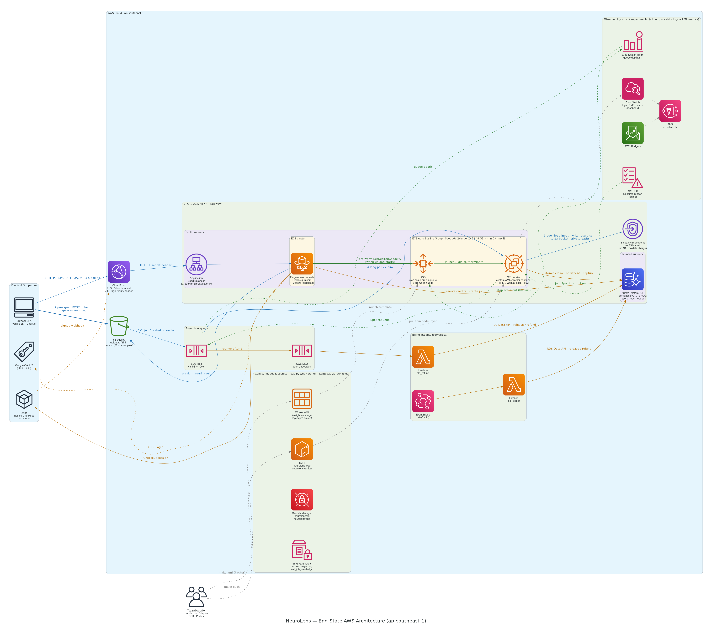

# NeuroLens

**Predict how viewers' brains respond to your video content — second by second — before you post it.**

NeuroLens is a cloud SaaS (NUS CS5224 project). You upload a video; a GPU worker runs Meta's
[TRIBE v2](https://github.com/facebookresearch/tribev2) to predict the cortical response of an average viewer,
turns it into five easy signals (faces, bodies, scenes, social cues, sound) plus a with/without-audio comparison,
and an LLM writes a PDF report with screenshots, charts, what works and what to improve.



**Contents**
1. [How it works](#how-it-works)
2. [Repository layout](#repository-layout)
3. [Run it locally](#run-it-locally-app_envdev)
4. [Deploy to AWS](#deploy-to-aws-app_envaws)
5. [Secrets and git](#secrets-and-git)
6. [Troubleshooting](#troubleshooting)
7. [Licence](#licence)

---

## How it works

1. **Sign in** (Google; a dev sign-in exists locally). New users get free credits.
2. **Upload**: the browser reads the video's length, the server reserves credits and returns a presigned S3
   upload URL. The video goes straight to S3 — never through the web server.
3. **Pre-warm**: at the same moment the server wakes a GPU, so the model loads while you upload.
4. **Queue**: S3 tells SQS a file arrived; a GPU worker claims the job (exactly one worker can).
5. **TRIBE v2, twice**: once with sound, once with the sound removed. Each second is mapped to five brain regions.
6. **Results**: charts appear (synced to the video), credits are charged for the real length, CSV export.
7. **AI report**: an LLM reads the numbers, transcript and key frames and writes a PDF, viewable in the page or
   downloadable.

Failures refund automatically: a job that fails twice lands in a dead-letter queue and is refunded; a reaper closes
anything stuck. Spot interruptions hand the job to another GPU without using up a retry.

## Repository layout

| Path | What it is |
|---|---|
| `packages/common/` | Shared Python: config, database, billing ledger, job rules, S3 keys, reaper SQL |
| `migrations/` | Postgres schema. All credit changes are SQL functions (one transaction each) |
| `web/` | Flask web tier + the dashboard (`web/static/`) |
| `worker/` | GPU worker: queue loop, TRIBE v2, ROI extraction, AI report (`worker/neurolens_worker/report/`) |
| `lambdas/` | AWS Lambdas: DLQ refund, SLA reaper |
| `infra/` | AWS CDK app (Python): network, data, compute, ops stacks |
| `ami/` | Packer template + boot scripts for the GPU worker AMI |
| `scripts/` | Dev stack launcher, end-to-end test, secrets upload, sample seeding, quota check, secret scanner |
| `docs/` | Architecture diagram, build checklist, prototype notes |
| `app.py`, `*.ipynb`, `static/` | The original single-machine prototype (kept for reference) |

---

## Run it locally (`APP_ENV=dev`)

Dev mode runs **the whole system on one machine**. Every AWS piece has a local stand-in:

| On AWS | Locally |
|---|---|
| Aurora PostgreSQL | Postgres container (`postgres:15`), data in `.dev/pgdata` |
| S3 + SQS + DLQ | [moto](https://github.com/getmoto/moto) server from a venv |
| CloudFront + ALB + Fargate | gunicorn on `localhost` |
| Spot GPU Auto Scaling Group | one always-on worker (real model on your GPU, or a mock) |
| Billing Lambdas + EventBridge | one reaper loop |
| Claude on Bedrock (AI report) | OpenAI API with your key (or a mock report) |

Nothing is installed system-wide: all Python goes into project venvs (`.venv-*`), and temp/caches go to `.dev/`.

### What your machine needs

| Need | Version / notes | Required for |
|---|---|---|
| Linux, `git`, `make` | — | everything |
| Python | 3.11 (`python3.11`) | everything |
| Docker | any recent; only runs the Postgres container | everything |
| `ffmpeg` + `ffprobe` on `PATH` | 6+ | everything (video checks, frames) |
| NVIDIA GPU + driver | ≥ 24 GB VRAM (peak use ≈ 11 GB), driver ≥ 525. CUDA itself comes inside the pip wheels | real model only |
| Disk | ~1 GB for mock mode; ~30 GB for the real model (9 GB venv + ~17 GB weights) | — |
| Node.js | 18+ | only `make cdk-synth` / AWS deploys |

### What you need to supply

All local settings live in **`.env`** (copy of `.env.example`; git-ignored, never committed).

| Setting in `.env` | Required? | What to put |
|---|---|---|
| `FLASK_SECRET_KEY` | yes | any long random string: `python3 -c "import secrets;print(secrets.token_hex(32))"` |
| `INFERENCE_BACKEND` | — | `tribe` (real model) or `mock`. `make dev-mock` forces mock anyway |
| `MODELS_DIR`, `HF_HOME`, `TORCH_HOME` | real model | folder holding the TRIBE v2 weights (see [Model weights](#model-weights)) |
| `HF_TOKEN` | only to download weights | Hugging Face read token with access to `meta-llama/Llama-3.2-3B` |
| `REPORT_LLM` | — | `mock` (sample report, no key), `openai`, or `off` |
| `OPENAI_API_KEY`, `OPENAI_MODEL` | if `REPORT_LLM=openai` | your OpenAI key and a model that accepts images + JSON-schema output |
| `DEV_PUBLIC_HOST`, `DEV_WEB_PORT` | — | `localhost` / `8000` by default. Set an IP (e.g. `192.168.0.17`) to open it to your LAN; pick a port your firewall allows |
| `GOOGLE_CLIENT_ID`, `GOOGLE_CLIENT_SECRET` | optional | Google sign-in locally (dev sign-in works without it) |
| `STRIPE_SECRET_KEY`, `STRIPE_WEBHOOK_SECRET` | optional | test-mode billing locally (see `make dev-stripe`) |

Everything else in `.env.example` (database URL, moto endpoints, queue URLs) already matches the dev stack.

### Quick start — no GPU needed (mock model)

```bash
git clone <repo-url> && cd <repo>
cp .env.example .env                 # then set FLASK_SECRET_KEY
make venv-dev                        # web, moto, mock worker, tests (~450 MB, in .venv-dev)
make dev-mock                        # Postgres + moto + web + reaper + mock worker
```

Open **http://localhost:8000** → **Dev sign in** (any email) → upload a video. Results arrive in seconds (fake
numbers); the AI report tab shows a sample PDF.

```bash
make test-e2e                        # browser-style end-to-end check (expect 6 × PASS)
make test                            # unit + integration tests (needs the dev Postgres running)
make dev-down                        # stop everything (database kept in .dev/pgdata)
```

### Real model on your GPU

```bash
make venv-worker                     # ~9 GB into .venv-worker; ends with: cuda True <n> GPU(s)
# set MODELS_DIR / HF_HOME / TORCH_HOME in .env (next section), INFERENCE_BACKEND=tribe
make dev                             # first start: ~20 s to load TRIBE v2
make dev-logs NAME=worker            # wait for: Worker … ready (tribe backend …)
make test-e2e VIDEO="data/videos/<some ad>.mp4"
```

Expect roughly 5 GPU-seconds per second of video per pass (two passes per job): ~1.5 min for a 10 s clip,
~5 min for a 30 s 1080p clip on an RTX 4090.

#### Model weights

The worker runs offline (`HF_HUB_OFFLINE=1`) against a folder of weights (~17 GB: TRIBE v2, V-JEPA 2,
Wav2Vec-BERT, LLaMA 3.2-3B, faster-whisper large-v3, WhisperX alignment model).

- **Already have them** (e.g. from the prototype notebooks): point `MODELS_DIR`, `HF_HOME` and `TORCH_HOME`
  (`<MODELS_DIR>/torch`) at that folder.
- **Download them**: accept the licence at https://huggingface.co/meta-llama/Llama-3.2-3B, put a read token in
  `HF_TOKEN`, then `make download-weights SAMPLE="path/to/a-video-with-speech.mp4"` (speech triggers the
  transcription and text models so they get downloaded too).

#### AI report locally

Set `REPORT_LLM=openai`, `OPENAI_API_KEY`, `OPENAI_MODEL` in `.env`, then `make dev-down && make dev`.
Settings load at start-up, so restart after any `.env` change.

### Open it to your LAN

```bash
# .env
DEV_PUBLIC_HOST=192.168.0.17      # this machine's IP
DEV_WEB_PORT=8080                 # a port your firewall allows
```

The app URL, the browser's S3 upload URL and the listening address all follow from these two lines. Google
sign-in only works on `localhost` (Google rejects plain-http redirects elsewhere); use dev sign-in on the LAN.

### Everyday commands

| Command | Does |
|---|---|
| `make dev` / `make dev-mock` | start everything (real / mock model) |
| `make dev-down` | stop everything |
| `make dev-status` | what is running |
| `make dev-logs NAME=web\|worker\|moto\|reaper` | follow a log |
| `make test` / `make test-e2e` | tests / end-to-end check |
| `make silent-check VIDEO=…` | compare the two silent-pass methods on one video |
| `make bench-local VIDEOS="a.mp4 b.mp4"` | GPU timings → `experiments/out/bench-local.csv` |
| `make help` | every target |

---

## Deploy to AWS (`APP_ENV=aws`)

### What gets deployed

Four CDK stacks in `ap-southeast-1` (Singapore):

| Stack | Contains |
|---|---|
| `NeuroLens-Network` | VPC across 2 AZs, **no NAT gateway**, security groups, free S3 gateway endpoint |
| `NeuroLens-Data` | S3 bucket (uploads 48 h, results 30 d), SQS jobs queue + DLQ, Aurora Serverless v2 (0–2 ACU, pauses when idle), ECR repos, SSM parameters. **Kept on teardown** |
| `NeuroLens-Compute` | CloudFront (HTTPS) → ALB → ECS Fargate web tier; Spot `g6e.2xlarge` GPU Auto Scaling Group (min 0) from the worker AMI |
| `NeuroLens-Ops` | DLQ-refund + SLA-reaper Lambdas, CloudWatch dashboard and alarms, SNS email alerts, AWS FIS Spot-interruption experiment, AWS Budget |

Idle cost is roughly the ALB + one small Fargate task + public IPs + Aurora storage (≈ $35–50/month). GPUs cost
nothing while no one is uploading.

### Tools you need

Install nothing system-wide: the CLIs below go into `.venv-tools` (`make venv-tools`) or run as containers.

| Tool | What it is for | Set it up |
|---|---|---|
| **AWS account + IAM** | Owns every resource; your CLI credentials | Console → IAM → Users → create `neurolens-admin` with `AdministratorAccess` (course project) → *Security credentials* → **Create access key** (CLI) |
| **AWS CLI** (`.venv-tools/bin/aws`) | Quotas, ECR login, SSM, CloudFormation outputs | `make venv-tools`, then `.venv-tools/bin/aws configure --profile neurolens` (region `ap-southeast-1`), then `export AWS_PROFILE=neurolens` |
| **Service Quotas** | GPU instances are **0 vCPU by default** on new accounts | `make quota-check`, then request **G and VT Spot vCPUs (L-3819A6DF) ≥ 16** and **G and VT On-Demand vCPUs (L-DB2E81BA) ≥ 8**. Approval can take days — do this first |
| **AWS CDK** (`.venv-tools/bin/cdk`, PyPI build) | Creates and updates all four stacks | Comes with `make venv-tools` (needs Node.js). Once per account: `make cdk-bootstrap` |
| **Docker** | Builds the web and GPU worker images | Needs ~15 GB free where Docker stores images (the GPU image is ~10 GB). If `/var/lib/docker` is on a small partition, move Docker's `data-root` first |
| **Amazon ECR** | Stores the two images | Repos are created by the `NeuroLens-Data` stack; `make push-web` / `make push-worker` log in and push |
| **Packer** (runs as the `hashicorp/packer` container) | Bakes the GPU worker AMI: weights + image layers pre-loaded, so a new GPU starts fast | Nothing to install; `make ami` runs it. Needs On-Demand G quota (bakes on a `g6e.2xlarge`, ~20 min, ≈ $1) |
| **Hugging Face** | Source of the model weights for the AMI | Accept https://huggingface.co/meta-llama/Llama-3.2-3B, create a read token, put it in `.env` as `HF_TOKEN` (used only during the bake) |
| **Amazon Bedrock** | Writes the AI report on AWS (Claude Opus 5.5, via the workers' IAM role — no API key) | Console → Bedrock → *Model access* → enable Anthropic Claude Opus 5.5 in your Bedrock region (`bedrock_region` in `infra/cdk.json`, default = stack region) |
| **Google Cloud Console** | Google sign-in for the deployed site | APIs & Services → OAuth consent screen (External, scopes `openid email profile`, add testers) → Credentials → OAuth client ID (Web). Redirect URI is added after the first deploy |
| **Stripe Dashboard** (test mode) | Credit purchases | Copy the test **secret key**; the webhook endpoint is added after the first deploy |
| **AWS Secrets Manager** | Holds the web tier's secrets on AWS | `make secrets` uploads `.env.deploy` (see below) and generates the Flask key + CloudFront origin secret |
| **CloudWatch, SNS, Budgets, FIS** | Dashboard, email alerts, cost alert, Spot-interruption test | Created by the stacks; set `alert_email` in `infra/cdk.json` and confirm the SNS email |

### Step by step

Run everything from the repo root with `AWS_PROFILE=neurolens` exported.

**1. Tools and access**
```bash
make venv-tools
.venv-tools/bin/aws configure --profile neurolens && export AWS_PROFILE=neurolens
make quota-check                       # g6e offered? quotas? → file quota requests if needed
make cdk-bootstrap
```
Enable Claude Opus 5.5 in Bedrock *Model access*. Set `alert_email` (and optionally `budget_usd`) in `infra/cdk.json`.

**2. Secrets** — create `.env.deploy` (git-ignored) with the deployed site's secrets:
```bash
GOOGLE_CLIENT_ID=...
GOOGLE_CLIENT_SECRET=...
STRIPE_SECRET_KEY=sk_test_...
STRIPE_WEBHOOK_SECRET=            # filled in at step 7
LOADTEST_TOKEN=                   # optional: enables load-test sign-in for Experiment 2
```
```bash
make secrets                          # → Secrets Manager "neurolens/app"
```

**3. Storage and registries first**
```bash
make deploy STACKS="NeuroLens-Network NeuroLens-Data"
```

**4. Images**
```bash
make push-web push-worker             # tag = current git commit
```

**5. GPU worker AMI** (needs `HF_TOKEN` in `.env` and On-Demand G quota)
```bash
make ami SAMPLE="data/videos/<a video with speech>.mp4"   # prints the AMI id (ami-…)
```

**6. Everything else**
```bash
make deploy CDK_ARGS="-c worker_ami_id=ami-xxxxxxxx -c web_image_tag=$(git rev-parse --short HEAD)"
make seed-samples                     # sample gallery → S3
```
The `NeuroLens-Compute` outputs print **PublicUrl** (`https://xxxx.cloudfront.net`), **OAuthRedirectUri** and
**StripeWebhookUrl**.

**7. Connect Google and Stripe to the new URL**
- Google Console → your OAuth client → add **OAuthRedirectUri** as an authorised redirect URI.
- Stripe Dashboard → Developers → Webhooks → add endpoint **StripeWebhookUrl** with events
  `checkout.session.completed` and `invoice.paid` → copy its signing secret into `.env.deploy` as
  `STRIPE_WEBHOOK_SECRET` → `make secrets` → `make restart-web` (the web tier reads secrets at start-up).

**8. Smoke test** — open **PublicUrl**, sign in with Google, upload a short video. The first job starts a GPU
(watch *CloudWatch → Dashboards → NeuroLens*); the AI report tab fills in after the charts.

### Updating a deployment

| Change | Command |
|---|---|
| Web tier code / frontend | `make release-web` |
| Secrets changed (`make secrets`) | `make restart-web` |
| Worker code | `make release-worker` (new GPUs pick it up; running ones finish their job first) |
| Worker Python dependencies or model weights | `make ami SAMPLE=…`, then `make deploy CDK_ARGS="-c worker_ami_id=<new>"` |
| Infrastructure | edit `infra/`, `make cdk-synth` to check, `make deploy CDK_ARGS=…` |

### Pausing and clean-up

```bash
make pause        # GPUs to 0 and web tasks to 0 — keeps everything else
make teardown     # destroys Compute + Ops; keeps the bucket, database and images
```
To remove everything: `make destroy-all` (asks to confirm), then empty and delete the S3 bucket and ECR repos in the
console (they are retained on purpose).

### To verify on first deployment

- `g6e.2xlarge` is offered in your region (`make quota-check`); otherwise change `region` in `infra/cdk.json`.
- Claude Opus 5.5 is available on Bedrock in `bedrock_region`, and the workers' IAM policy
  (`bedrock:InvokeModel*`) covers the Bedrock Messages endpoint used by the report step.
- Peak VRAM is ~11 GB, so a 24 GB GPU (e.g. `g6.xlarge`, NVIDIA L4) may be enough and cheaper — set
  `worker_instance_types` in `infra/cdk.json` to try it.

---

## Secrets and git

| File | Holds | In git? |
|---|---|---|
| `.env` | your local settings and keys (OpenAI, Google, Stripe, HF) | **never** — git-ignored |
| `.env.deploy` | the deployed site's secrets, uploaded by `make secrets` | **never** — git-ignored |
| `config.json` | the prototype's Hugging Face token | **never** — git-ignored |
| `.env.example` | the template with empty values | yes |

On AWS, secrets live only in Secrets Manager (`neurolens/app`, `neurolens/db`) and are read by IAM role at run
time; images, AMIs and CloudFormation templates contain none.

Two safety nets:
```bash
make install-hooks     # once per clone: a pre-commit hook refuses commits with secrets or .env files
make check-secrets     # scan everything git would see — run before every push
```

## Troubleshooting

| Symptom | Fix |
|---|---|
| Page unreachable from another machine | Set `DEV_PUBLIC_HOST` to this machine's IP and `DEV_WEB_PORT` to a port the firewall allows, then `make dev-down && make dev` |
| Upload never starts | The browser posts straight to the S3 stand-in on port `5055`; that port must be reachable too |
| Job fails twice, credits refunded | `make dev-logs NAME=worker` shows the error; on AWS see the `/neurolens/worker` log group |
| AI report: "OPENAI_API_KEY is not set" | Put the key in `.env`, then restart (`make dev-down && make dev`) |
| `make test` cannot connect to Postgres | Start the stack first (`make dev-mock`) |
| Worker: CUDA out of memory | Another process holds the GPU; pick one with `CUDA_VISIBLE_DEVICES=1 make dev` |
| Docker fills the root disk | Move Docker's `data-root` to a larger partition before `make push-worker` / `make ami` |

## Licence

Course project, non-commercial. TRIBE v2 is released under CC BY-NC 4.0; LLaMA 3.2 under Meta's licence.
Commercial use would need a commercial model licence. Prototype notes: [`docs/PROTOTYPE.md`](docs/PROTOTYPE.md).
