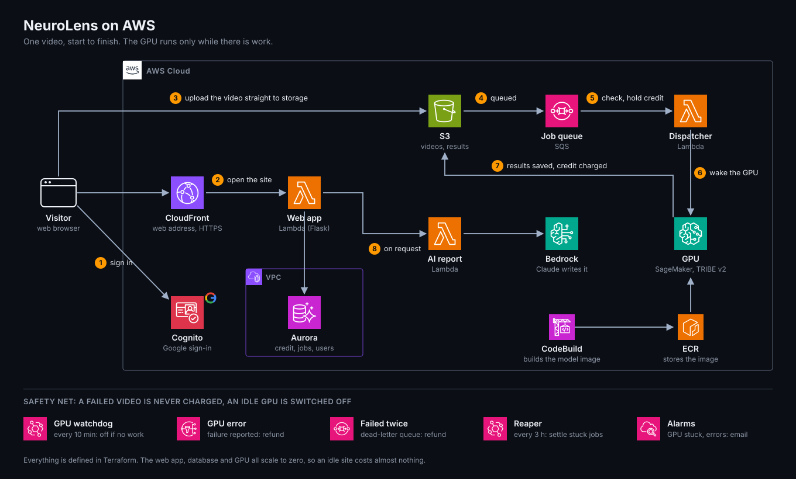

# Architecture

NeuroLens runs on Amazon Web Services (AWS). Amazon CloudFront (AWS's content delivery network) serves the page and forwards API calls to a Flask app in AWS Lambda (functions that run on demand). Amazon Cognito (AWS's sign-in service) handles Google or email sign-in. Amazon S3 (object storage) holds videos, results and model files. Amazon Simple Queue Service (SQS) holds one message per upload. An asynchronous Amazon SageMaker endpoint (a managed machine-learning service with a queue in front of the GPU) runs the model on a graphics processing unit (GPU). Amazon Aurora (a managed PostgreSQL-compatible database) holds users, credit and job state through the Amazon RDS Data API (SQL over HTTPS). Amazon Bedrock (managed access to foundation models) writes the optional AI report. Terraform (infrastructure as code) creates the AWS resources from `infra/terraform/`.

## The path of one video

1. **Sign-in.** The browser signs in on Cognito's hosted page with Google or an email and password. The callback accepts only a verified email, maps the sign-in's issuer and subject to a `users` row, and starts a server-side session. The browser cookie holds a random token; the server stores its hash (`neurolens/web/auth.py`, `neurolens/web/app.py`).
2. **Credit check and reserve.** `POST /api/uploads/presign` checks that GPU work is not paused, that the claimed length and size fit the limits, that the account has fewer than ten queued jobs, and that research consent is current. `billing.reserve` then moves the estimated price from available to reserved credit and creates a `queued` job (`neurolens/web/app.py`, `neurolens/billing.py`, `neurolens/pricing.py`).
3. **Upload to S3.** The web function returns a presigned POST: a time-limited signed form that lets the browser write one object without AWS credentials. It expires after 300 seconds, and S3 enforces one key, one content type and the size cap. The object lands at `uploads/{user_id}/{job_id}{ext}` (`neurolens/storage.py`).
4. **Queue.** S3 sends an object-created event to the `neurolens-jobs` SQS queue; SQS delivers it after a 15-second delay, so a user can still cancel. The queue hides a delivered message for 1,080 seconds, and a message received twice goes to the dead-letter queue (a queue for messages that keep failing) (`infra/terraform/main.tf`).
5. **Dispatcher Lambda.** `neurolens-dispatcher` consumes one message at a time. It checks the object size, runs `ffprobe` from a Lambda layer (a zip of extra files loaded beside the function), re-prices the job by the measured duration, checks the job deadline and whether processing is paused, then calls SageMaker's asynchronous `InvokeEndpointAsync`. It also asks the endpoint for one instance, so the cold start does not wait for the scaling alarm (`neurolens/lambdas/dispatcher.py`).
6. **SageMaker asynchronous endpoint and worker container.** SageMaker starts an instance from the first available pool. The container in `neurolens/worker.py` receives the video on `/invocations`, claims the job, runs TRIBE v2 with audio and again with the sound removed, and extracts the seven brain signals. A heartbeat runs every 50 seconds; a job that reaches 55 minutes ends the process so SageMaker replaces the container (`config.json`, `neurolens/worker.py`).
7. **Results to S3.** The worker writes `results/<job_id>.json` with the signal series, `results/<job_id>.brain` with the raw predictions, and the thumbnail, frames and phone-playback copy beside them. A consented job also gets `dataset/<job_id>/video.*` (`neurolens/storage.py`, `neurolens/worker.py`).
8. **Charge or refund.** On success `settle_success` moves the reservation to captured. The job's failure paths call `issue_refund`, which returns the reservation to available credit. A unique database index allows at most one capture or one refund per job (`neurolens/billing.py`, `infra/migrations/004_one_ending_per_job.sql`).
9. **AI report through Bedrock.** After a successful result, `POST /api/jobs/<job_id>/report` claims one free attempt and invokes the `neurolens-report` Lambda asynchronously. That function reads the result and frames, calls Bedrock's Claude Sonnet 4.6, checks the answer's shape and time spans, and stores `results/<job_id>.report.json` (`neurolens/lambdas/report.py`, `config.json`).
10. **The page shows the result.** The page polls `/api/jobs/<job_id>/status` and reads `/api/jobs/<job_id>/result`, which adds the sound-share summary at serve time. Charts use the result endpoint, and the 3D brain reads the `.brain` file through a five-minute presigned GET link. CSV and PDF downloads come from the web Lambda (`neurolens/web/app.py`, `neurolens/results.py`).

## Data

### Aurora tables

The schema is in `infra/migrations/` and `infra/apply_schema.py` applies each file once.

- `users`: one row per account, with the email and a deletion mark.
- `balances`: available and reserved credit in cents, both constrained to zero or more.
- `identities`: the sign-in issuer and subject linked to one user.
- `jobs`: the upload key, file name, status and stage list, client and measured durations, reserved and captured cents, research consent and version, video hash, claim time, retention and reward fields, report state, and the deletion mark.
- `ledger`: one row for every balance change, with its kind and the available and reserved deltas.
- `retention_snapshots`: one stored audience curve, its raw and CSV keys, its hash, quality flags, views, publish data, reward, linked video, cut answer and source.
- `comparisons`: one row per pair of videos, with the comparison report's state and tries.
- `sessions`: the hash of each sign-in token, its user and its last use.
- `access_requests`: one screened request per account, with the channel link, platform, note and status.
- `schema_migrations`: the migration files already applied.

### S3 prefixes

S3 stores objects under key prefixes (the start of a key, like a folder). The bucket is private, encrypted at rest, and refuses anything except HTTPS (`infra/terraform/main.tf`).

- `uploads/`: the input videos; expires after 30 days.
- `results/`: result JSON, brain file, thumbnail, frames, playback copy and reports; expires after 30 days.
- `dataset/`: consented shared videos and retention snapshots; expires after 1,095 days.
- `sagemaker-output/`: SageMaker's asynchronous success and failure answers; expires after 1 day.
- `build/`: the source zip for an image build; expires after 7 days.
- `model-data/`: the model weights and brain maps copied into the GPU container at start; no expiry rule.
- `experiments/`: boot records and experiment output; no expiry rule.
- `deploy/`: the web Lambda zip; no expiry rule.
- `site/`: the public page and samples served by CloudFront; no expiry rule.

### Retention and deletion

- S3 lifecycle rules delete `uploads/` and `results/` after 30 days, `sagemaker-output/` after 1 day, and `build/` after 7 days. `dataset/` lasts 1,095 days and `experiments/` never expires (`infra/terraform/main.tf`).
- The page marks a result available only for 30 days, and a missing result answers `result_expired` (`neurolens/web/app.py`).
- A shared copy with no retention curve is removed after 90 days; the number is `research.no_curve_days` in `config.json`, and the reaper applies it (`neurolens/lambdas/reaper.py`).
- A user can stop sharing a copy or delete a job immediately. The job is marked first and the files are deleted; the reaper finishes anything a failed delete leaves (`neurolens/billing.py`, `neurolens/lambdas/reaper.py`).
- Account deletion marks the account, removes its sign-ins, deletes its files and then its rows. Deleting an account is refused while one of its jobs is queued or processing (`neurolens/web/app.py`, `neurolens/billing.py`).
- Sign-in sessions expire after 30 days from last use (`neurolens/billing.py`). A report that stays `writing` for 16 minutes is treated as stale (`config.json`).
- Amazon CloudWatch (AWS's monitoring and log service) keeps the logs 14 days by default (`infra/terraform/variables.tf`).

## Safety nets

- **GPU guard.** A Lambda runs every 10 minutes and stops the endpoint when an instance is running or wanted, no keep-warm holds it, and no live claim, dispatched request or recent job activity says work is coming. It reads the database, not the backlog metric (`neurolens/lambdas/gpu_guard.py`, `infra/terraform/lambdas.tf`).
- **Reaper.** A Lambda runs every 3 hours. A job still open four hours after creation is settled if its result exists, otherwise refunded `deadline_passed`. It also retries recent failed file deletes, removes shared copies with no curve after 90 days, finishes marked purges, deletes marked accounts, removes snapshots older than 1,095 days and deletes expired sessions (`neurolens/lambdas/reaper.py`).
- **Dead-letter handler.** A message that fails twice on the jobs queue goes to the dead-letter queue. Its Lambda settles the job if a result exists, otherwise refunds it `processing_failed` and deletes its files. If a worker still holds a fresh claim, the handler raises so the message is tried again (`neurolens/lambdas/dlq_handler.py`, `neurolens/lambdas/__init__.py`).
- **SageMaker error handler.** The endpoint's error topic invokes a Lambda for each failed asynchronous request. It settles or refunds the job and ignores SageMaker's own start/stop test notification. A fresh claim makes it retry later; the reaper is the final backstop (`neurolens/lambdas/gpu_failed.py`).
- **Alarms.** CloudWatch emails one Amazon Simple Notification Service (SNS, AWS's notification service) topic when the GPU guard stops a GPU, when the guard asks twice in 30 minutes, when the guard does not run for 30 minutes, when Aurora stays awake for much of six hours, and on any Lambda error. A failed Cognito login deletion has its own log-based alarm (`infra/terraform/alarm.tf`, `infra/terraform/database.tf`).
- **Budget.** Terraform creates no budget. The setup guide recommends an optional manual AWS Budgets alert at an amount the account owner chooses (`infra/terraform/README.md`). AWS Budgets is AWS's cost-alert service.
- **Queue and request deadlines.** The dispatcher gives each request a queue time to live that ends before the reaper's four-hour bound. SageMaker's invocation timeout is one hour, and the worker's own job cap is 55 minutes (`neurolens/lambdas/dispatcher.py`, `config.json`).

## Credit and billing

The price is one dollar per started 30-second block, with a half-second allowance and a minimum of one block (`neurolens/pricing.py`).

1. **Reserve.** At upload, the web function estimates the price from the browser's duration and moves it from available to reserved.
2. **Verify.** The dispatcher measures the real duration and re-prices the job. A longer video needs more available credit; if that is missing, the job is refunded before a GPU starts. A video above the 120-second limit is refunded first (`neurolens/billing.py`).
3. **Charge.** A result settles the job once: reserved credit becomes captured credit.
4. **Refund.** A failed, cancelled or expired job returns its reservation to available credit. A refund also deletes the job's files.

The ledger invariants are in `neurolens/billing.py` and `infra/migrations/`:

- Every balance change writes its ledger row in the same transaction.
- The balance row is locked before the job row, so money transactions share one lock order.
- A job ends at most once. A partial unique index allows one `capture` or one `refund` row per job.
- Balances can never go negative.
- Available plus reserved equals the sum of the ledger deltas for that user.

**Rewards.** A stored audience curve can return the job's captured price once. The checks run before anything is written (`neurolens/billing.py`):

- The curve must be valid: at least 20 points, a watch-ratio spread of at least 0.02, a falling or flat ending, and no value above 10 (`neurolens/results.py`).
- The job must be done, shared, charged, not deleted, and not already rewarded.
- The account must have had credit beyond the starter grant, and must have fewer than five rewards in the last 30 days (`research.curve_rewards_per_window` and `curve_reward_window_days`).
- The video's measured length must match the analysed length within two seconds; the analysed length is the server's own measurement (`research.curve_length_tolerance_s`).
- When a view count is known, it must be at least 1,000 (`research.curve_min_views`).
- The same video hash and the same published link can each be rewarded only once. The link is stored on the job, so deleting the shared copy cannot forget the reward.
- One exact curve (by hash) is stored once across all jobs and accounts. A published link cannot be stored by a second account, and one analysis cannot switch to a different link.

## Sign-in and admin

**Dev mode.** `config.json` sets `auth.mode` to `dev`. The app uses one fixed development user on `127.0.0.1` only, creates that user with the starter credit on first use, and refuses to start in dev mode on AWS or on any other host (`neurolens/web/auth.py`, `neurolens/settings.py`).

**Cognito mode.** On AWS, Cognito hosts the sign-in page; Google and email/password are the providers. The app stores its own session token, not the Cognito token, and reads the user's email from the database. A changed email needs verification before it can update the account. The Terraform configuration and first-time steps are in `infra/terraform/web.tf` and `infra/terraform/README.md`.

**Admin panel.** The `Admin` button appears when the signed-in email is in the admin list: Terraform's `admin_emails`, or `NEUROLENS_ADMIN_EMAILS` on a laptop. An empty list means nobody can open it. The panel is in `static/app.html`; its routes are in `neurolens/web/app.py` (`/api/booth/pass`, `/api/booth/stats`, `/api/booth/passes`).

- **Delegated admins.** Admin rights come from the email list. To delegate, add the person's email to `admin_emails` in Terraform and apply, or to `NEUROLENS_ADMIN_EMAILS` on a laptop and restart. The panel does not add or remove admins.
- **Visitor passes.** The panel makes a signed QR code for a two-minute guest pass. The pass pool starts at ten passes of 400 cents each; `+5 passes`, `+10 passes` and `Stop passes` change it. Each scan creates or joins a `guest-` account. A copied link joins the same guest session without spending a second pass; two different phones scanning the same code get separate guest accounts (`neurolens/billing.py`, `neurolens/web/app.py`). Guest accounts never receive research consent (`neurolens/web/app.py`).
- **GPU warmth and credit.** The panel sets the endpoint to auto-scale (`0`), or keeps one or two GPUs warm for six hours. It grants or resets credit for an email in `0`, `2`, `5` or `10` minute steps; `+5 min` is the invite credit (`neurolens/web/app.py`, `config.json`).
- **Access requests.** A signed-in user asks for free minutes with a YouTube, Facebook, TikTok or Instagram channel link. The request row is the list; an SNS email notifies the operator (`neurolens/access.py`, `neurolens/notify.py`). `infra/access_requests.py list --backend data_api` shows waiting requests, and `decline` turns one down. Granting credit in the panel marks the request granted.

## Design decisions

### Scale-to-zero SageMaker asynchronous endpoint instead of an EC2 GPU group

- **Choice:** one SageMaker asynchronous endpoint with instance pools, minimum zero and maximum one by default.
- **Why:** it fits the current scale. The site pays only while a GPU works, has no machine to patch or drain, and AWS queues requests when no instance is free. Fallback instance pools keep the service working when the first GPU type has no capacity (`infra/terraform/sagemaker.tf`).
- **Trade-off:** per GPU-hour, SageMaker costs more than a self-managed group at high volume, and a cold start or a capacity shortage makes people wait. The self-managed Amazon Elastic Compute Cloud (EC2, virtual servers) version is kept at git tag `custom-gpu` (`git tag`).

### Aurora Serverless v2 pausing to zero

- **Choice:** Aurora PostgreSQL Serverless v2 with 0 to 1 Aurora Capacity Unit (ACU), a 300-second auto-pause, and access only through the RDS Data API.
- **Why:** an idle database costs no compute, and no workload opens a database port. The database sits in a virtual private cloud (VPC, an isolated network) with no internet route and no NAT gateway (a managed internet gateway for private subnets) (`infra/terraform/database.tf`, `infra/terraform/network.tf`).
- **Trade-off:** the first call after a pause waits about 15 seconds for the database to wake. The Data API runs one statement per call, and the client retries only calls the database never ran (while it wakes), so the billing code is written to make a caller's retry safe (`neurolens/db.py`).

### A Lambda web tier

- **Choice:** the Flask app runs as one arm64 Lambda behind CloudFront, with 1,769 MB of memory and a 60-second timeout.
- **Why:** there is no server to run, the tier scales with requests, and the site pays per request. CloudFront signs its requests to the function URL, so the URL is not public (`infra/terraform/web.tf`).
- **Trade-off:** a cold start adds seconds to the first request, and the 60-second limit rules out long work. Reports run in a separate Lambda with a 900-second timeout, and analysis runs in the GPU container (`infra/terraform/lambdas.tf`).

### The g6e/L40S GPU choice

- **Choice:** `ml.g6e.xlarge` (NVIDIA L40S) first, then `ml.g6.2xlarge` (L4), `ml.g5.2xlarge` (A10G) and `ml.g6e.2xlarge` as fallbacks. All run on demand, not Spot (AWS's spare-capacity pricing).
- **Why:** the pipeline peaks at about 20 GB of GPU memory, and each type leaves at least 32 GB of system memory. The L40S finished the tested clips fastest per dollar. Spot saved little and often had no capacity (`infra/terraform/sagemaker.tf`, `docs/evidence/README.md`).
- **Trade-off:** L40S capacity is scarce. A fallback GPU keeps the site working but takes longer and costs more per video. SageMaker refuses a CUDA image on a CPU instance, so there is no cheap CPU rehearsal of the image (`infra/terraform/sagemaker.tf`).

### Signed brain signals with no rescaling

- **Choice:** show signed means, with zero meaning typical film or TV viewing. There is no absolute value and no rescaling. The muted series are cut to the shared length of the two passes.
- **Why:** TRIBE v2's training data are fMRI responses standardised per cortical point, so zero is the model's built-in reference and two videos can be compared directly. The value rule is in `AGENTS.md`; the extraction is in `neurolens/response.py`.
- **Trade-off:** the numbers are relative to typical viewing, not absolute brain activity, and they are not a forecast of views, retention or sales.

## Known limitations

- **Audience-curve rewards depend on invite-only accounts and manual checks.** A reward needs an account that has had credit beyond the starter, so the invite step limits who can earn one. The operator still screens requests by hand. YouTube's public length and view count can be gamed, and the site does not verify that the signed-in account owns the channel (`neurolens/web/app.py`, `neurolens/youtube.py`, `neurolens/access.py`).
- **Facebook retention cannot be checked automatically.** `video_facts` returns no facts for Facebook, so the length and view checks do not run there. The user pastes a retention report and the site parses it (`neurolens/web/app.py`, `neurolens/results.py`).
- **Facebook Reels and short links are not accepted.** The form asks for the full Facebook page address (`neurolens/results.py`).
- **The proper fix for these reward checks** is to have the owner sign in with YouTube Analytics or Facebook Page Insights, so the site reads the numbers itself. That needs app review by Google or Meta.
- **The AI report cannot hear the soundtrack.** It reads frames and spoken words plus the predicted signals; the prompt says so (`neurolens/report_prompt.py`).
- **The model predicts perception, not persuasion.** TRIBE v2 predicts how an average viewer's brain responds to what is seen and heard, on the brain's surface. It is not a real brain scan, and it does not measure emotion, reward or intent to buy, so NeuroLens reports attention to sights, sounds and speech, not whether an ad will sell.
- **Non-commercial use only.** The TRIBE v2 model is licensed CC BY-NC, so NeuroLens cannot be sold as is.
